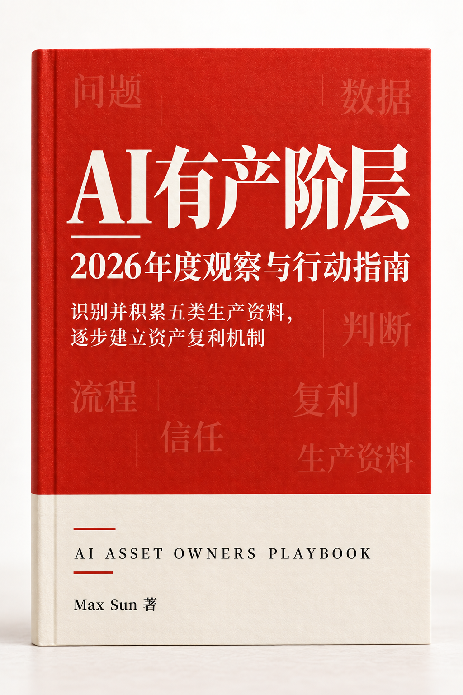

# AI 有产阶层

### 当 AI 让执行越来越便宜，我们还可以留下什么？

**一本面向普通职场人的 AI 工作与个人成长实践指南**  
识别五类资产 · 找到一个真实问题 · 用四周留下第一份可复用成果

[开始阅读](book/01-开始阅读.md)　|　[查看目录](#阅读目录)　|　[直接开始四周实验](book/04-实践画布与来源.md)　|　[提交反馈](https://github.com/maxsuncn/AI-Asset/issues)

Max Sun 著 · 科技小虎哥

---

## 用完 AI，你留下了什么？

一份报告交上去，下周还得从头写；一次客户咨询结束，关键判断没有记下，下次遇到类似问题，又要重新想一遍。

AI 可以帮我们更快地完成任务。但更值得追问的是：**这次工作的哪些部分，能让下一次做得更好？**

这本书把答案拆成五类可以逐步积累的资产：**问题、数据、判断、流程和信任**。你不需要辞职、创业或搭建复杂系统，可以从当前工作中一个反复出现的小问题开始。

> 例如，团队经常回答新人关于产品适用条件的问题。先整理现行资料和真实提问，让 AI 帮忙起草，由业务人员核对版本、条件与例外，再记录新人仍不理解的地方。下一次留下的不只是答案，还有来源、判断和可改进的模板。

## 你会在书中得到什么

- **一张资产地图**：分清问题、数据、判断、流程和信任，找到适合自己的起点。
- **10 张案例卡**：从电商退货、钢球质检到培训与内容创作，观察 AI 怎样接入具体工作，以及哪些判断仍需人负责。
- **三种积累路径**：从信息与决策、专业判断与信任、流程与组织生产三个方向找到切入口。
- **一套实践画布**：用四周实验、一次交付记录卡和九十天复盘，把想法变成可以检验的行动。

## 适合谁读

- 想用 AI 改善工作，但不想一直追逐新工具的职场人。
- 希望把经验和判断传递给团队的业务负责人、专业人士与管理者。
- 正在积累作品、方法、客户理解和长期能力的创作者与独立工作者。

不需要编程背景。部分案例发生在企业中，读者可以按自己的权限与实际工作条件缩小尝试范围。

## 阅读目录

| 阅读文件 | 内容 |
| --- | --- |
| [01｜从这里开始：什么才算拥有](book/01-开始阅读.md) | 了解问题、个人与组织的资产边界。 |
| [02｜五类资产与案例](book/02-五类资产与案例.md) | 认识问题、数据、判断、流程和信任，从真实场景中找起点。 |
| [03｜三种飞轮与长期经营](book/03-飞轮与长期经营.md) | 让经验支持下一次交付，并核算时间、维护和人需要作的判断。 |
| [04｜实践画布与来源](book/04-实践画布与来源.md) | 使用案例索引、四周实验、交付记录和九十天复盘画布，查看来源说明。 |

📖 **[下载 PDF 完整阅读版](AI有产阶层-阅读版.pdf)**：适合离线阅读与转发，文末附公众号二维码。

### 没时间从头读？

1. **10 分钟理解全书**：[五类资产](book/02-五类资产与案例.md) → [三种飞轮与四周实验](book/03-飞轮与长期经营.md)。
2. **想马上动手**：打开[实践附录](book/04-实践画布与来源.md)，选择一个真实任务，填写四周实验画布。
3. **先找同行案例**：打开[案例索引](book/04-实践画布与来源.md)，按相近工作回到相应章节。

## 关于案例与证据

本书把案例中的实践过程、本书提出的积累方向和读者行动建议分开说明。研究结论只在相应样本和条件下理解；正文中的假设场景和时间账仅用于演示。部分实践案例依据作者整理的材料，公开原始出处仍待补充；[来源说明](book/04-实践画布与来源.md)列出了目前可直接查阅的部分研究和资料。

本书讨论的是工作方式，不是收入承诺或对人的价值排序。涉及岗位资料、客户信息和组织知识时，请先确认实际使用权限。

## 参与完善

欢迎通过 [Issue](https://github.com/maxsuncn/AI-Asset/issues) 提出错误、补充来源，或分享你尝试画布后的发现。提交案例时，请只分享有权公开的信息。

如果这本书对你有帮助，欢迎 **Star**，或分享给正在尝试用 AI 改善工作的人。

## 许可

本仓库沿用现有的 [MIT License](LICENSE)。第三方来源的名称、引用及材料仍以各自权利和使用条件为准。
