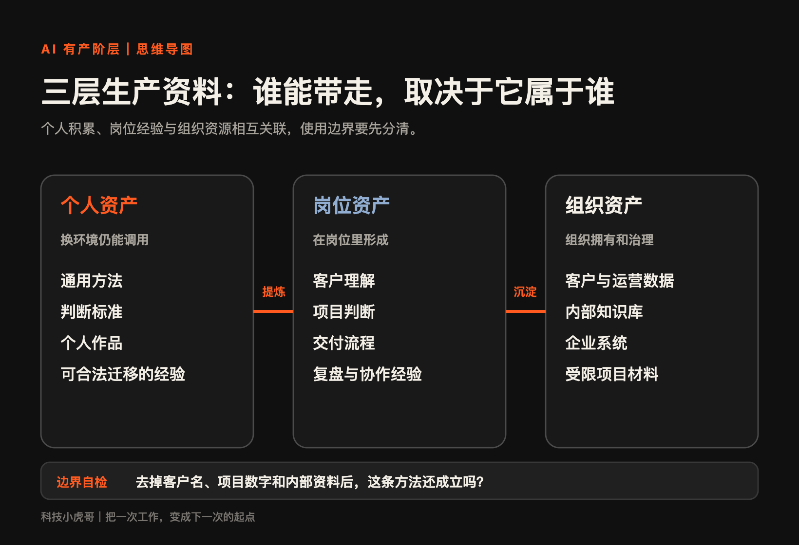

[← 返回首页](../README.md) | [五类资产与案例 →](02-五类资产与案例.md)

---

## 当执行越来越便宜，什么才值得拥有

上海一位升学规划师，持续整理招生政策、学校历年录取数据，以及家庭咨询和决策记录。一个家庭来问该选哪所学校、是否需要换房，她可以把公开信息和具体条件放在一起判断。

北京一位体育专业毕业的姑娘，在社区带孩子做运动训练。她按孩子的体能和目标安排内容，每次训练后向家长反馈练了什么、哪里有变化，再通过体验活动让老客户带新客户。

两个案例看起来和AI无关，她们也没有复杂系统，但却已经在积累问题、数据、判断和信任。每次服务，都为下一次留下依据。

AI 可以几分钟生成报告、文章和表格，但很多人下周仍要从头开始。差别在于：这次完成的工作，有多少能支持下一次？

这本书讨论一个问题：当部分执行成本下降，普通人值得积累什么，才能减少重复劳动，增加选择？我们从问题、数据、判断、流程、信任五类资产入手，先辨认归属，再看它们怎样接成持续改进的回路。

开篇是匿名从业观察，不作收入或效果证明。案例卡区分实际做法与本书建议；实践附录和来源说明放在书末。

---

## 1. AI 让工作变便宜之后，什么才算「拥有」

### 1.1 有些人完成了任务，有些人留下了生产资料

一份报告交上去，下周的还得从头写。
一次客户咨询结束，客户说的话、当时做的判断没人记下，下次遇到类似问题，还得重新想一遍。
一节训练课上完，家长只知道「今天上了一节课」，看不出孩子半年到底进步在哪。
一次投标完成，团队关于风险的判断、关于报价的取舍，没留在任何地方，换个人接手，一切推倒重来。
共同点只有一个：经验只存在于某个人的记忆里。记忆调用成本高，还会随人员流动消失。

留资产，往往比完成任务更费时间。
记录一次判断，整理一份字段，写一份可复用的模板，短期看都是在浪费效率：本来十分钟交差的事，现在要十五分钟。时间一紧，人们第一个砍掉的，就是这部分「多余」的记录动作。
能否留下这部分积累，既取决于意愿，也取决于时间、权限和奖励反馈条件。

一次交付可以顺手留下三样东西：实际遇到的问题、最后采用的办法、下次要避开的例外。

### 1.2 为什么偏偏是现在

过去，整理问题、统一数据、写清判断标准，都需要额外的时间和技能。记录带来的收益又常在以后出现，人们更容易先完成眼前的任务。

AI 可以协助转写、摘要、分类和生成检查清单，降低整理的起步成本。原本嫌麻烦、不值得做的小型知识库和工作模板，现在有了尝试的条件。

核验和维护仍要花时间。但机会已经改变：除了加快这次交付，我们也可以把一部分精力用于减少下次的重复劳动。

### 1.3 AI 把执行变成廉价服务

写初稿、翻译、清洗数据和回答标准问题，越来越多可以先交给 AI，再由人检查。通用执行的门槛降低，选择问题、核实依据、验收结果和承担责任，变得更重要。

“我会做”之外，还需要说明：该做什么，怎样才算做好，为什么值得别人采用。

美国的一家公司Quiver Quantitative 把政府合同等分散信息整理成结构化数据，提供网页查询和 API 等调用方式。同一批持续维护的数据，可以接入不同用户的研究流程，形成多种服务出口。

森马旗下的森创启睿，把电商客服中改地址、换颜色、换款式等重复操作整理成流程。团队识别了约四百个可自动化场景；运行日志和异常记录，又用于判断哪些场景适合继续自动化。留下来的，是场景库和修正规则，不只是一次节省。

这种变化在“执行较标准、判断依赖具体条件”的工作中尤其明显。合同可以先起草，客户的关键风险仍需律师判断；病历可以先摘要，治疗意见仍由医生结合具体病人作出。高度标准化、判断空间小的任务，则更直接地面对执行成本下降。

### 1.4 AI 有产不等于辞职、创业或做自媒体

积累生产资料可以发生在当前岗位，不必先辞职、创业或做自媒体。一个人整理方法，团队沉淀项目经验，企业维护知识系统，都可能形成可持续使用的能力。

这里要拆成三种存在方式：

- **个人资产**：一个人能自己控制、调用，有权在不同工作中继续使用的资料、方法、作品和判断。
- **岗位资产**：在组织内部，因长期做同一类事形成的客户理解、交付流程和项目判断。依托岗位形成，由具体的人操作和维护；使用范围需要结合组织约定判断。
- **组织资产**：企业内部沉淀的知识库、客户记录、现场运行数据，以及能持续运转的 AI 系统。它属于公司，不属于个人。

经验写成规则后，可能同时服务个人、岗位与组织，归属不能仅凭谁整理来判断。

以设备维护为例，识别异常的顺序可以提炼成个人方法；某条产线的维修记录、配置与供应商合同，则依托具体岗位和组织。分开保存方法与原始资料，核对使用约定，才能知道哪些可以继续调用、哪些不能带走或公开。

2.6 讨论组织内怎样积累，4.3 进一步讨论控制、使用和收益。

*图 1｜个人、岗位与组织中的生产资料*

---

[← 返回首页](../README.md) | [五类资产与案例 →](02-五类资产与案例.md)
