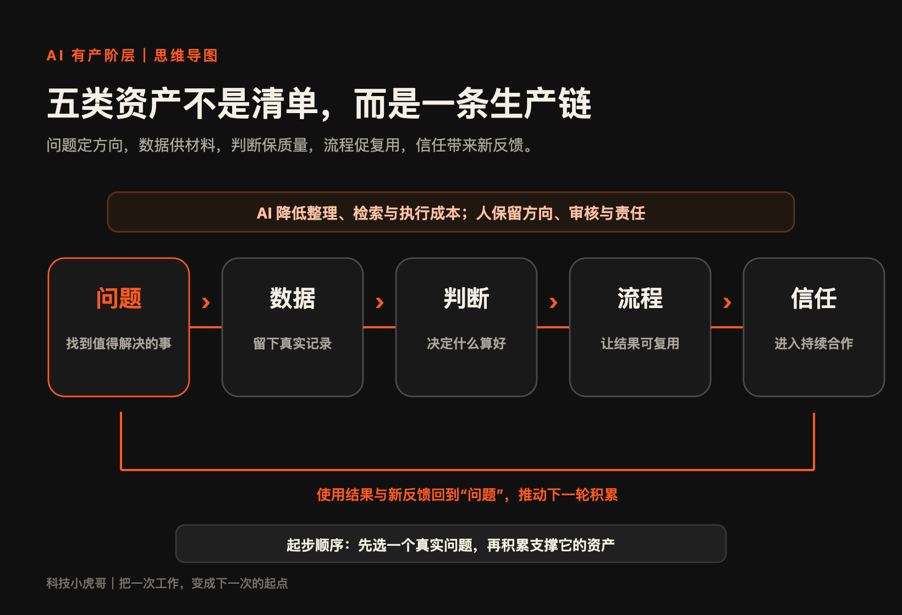
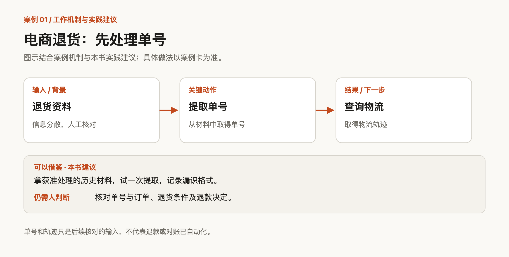
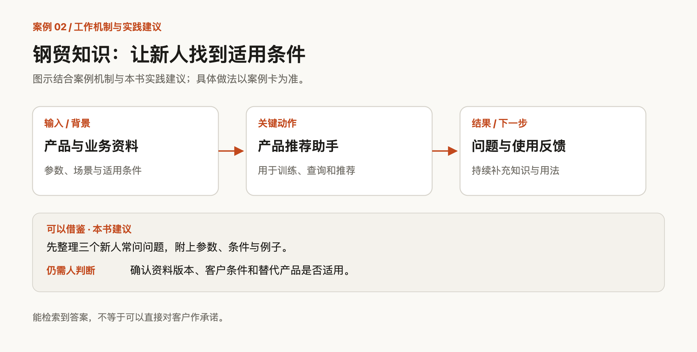
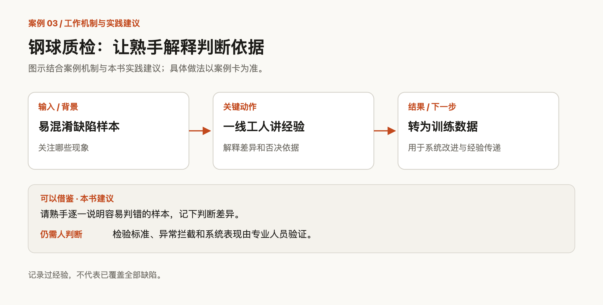
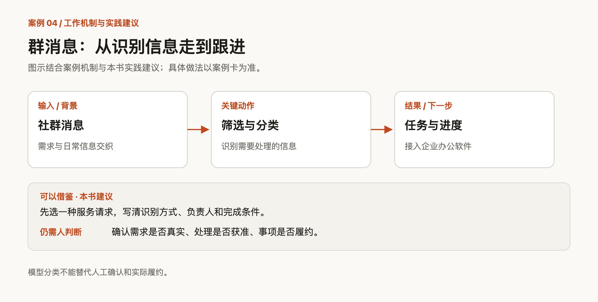
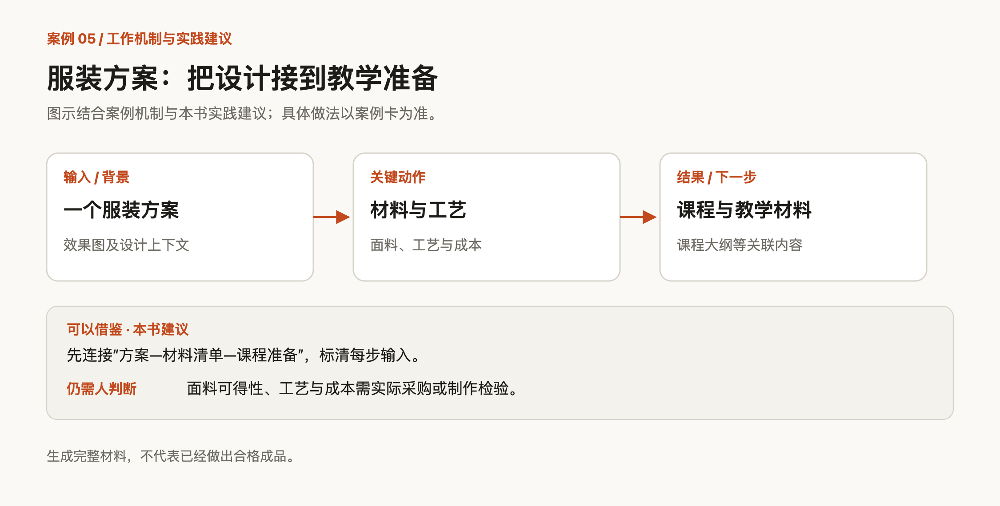

[← 返回首页](../README.md) | [← 从这里开始：什么才算拥有](01-开始阅读.md) | [三种飞轮与长期经营 →](03-飞轮与长期经营.md)

---

## 2. AI 时代的五类资产

五类资产可以接成一条链：问题定方向，数据提供依据，判断作取舍，流程组织交付，信任支持下一次合作。新的使用反馈，再回到链条起点。

不必平均积累。产品咨询可能以问题和数据为主，专业服务可能以判断和信任为主，再配上必要的记录与流程。

这是本书分析工作的框架。AI 可以参与各环节，目标、权限和责任仍由人及组织确定。

*图 2｜五类资产怎样连成一条生产链*

整理可以加快，验证仍要等待真实使用。建议是否适用、流程能否应对例外，都需要反馈。

### 2.1 问题资产：先找到值得反复问的问题

问题资产，是对一类反复出现的困难有持续、具体的理解：谁遇到它，付出了什么代价，是否愿意配合解决。

从客户咨询、会议争议和返工记录中找线索，记下频次、代价、现有办法与愿意试用的人。AI 可以合并相似描述、整理问题清单；投入哪个问题，由人判断。

先把“提高效率”缩成一个可验收的动作，才容易看见进展。

> **案例卡 C01｜石云升：先解决退货单号这一步**
>
> **WHY原有痛点**　电商退货信息分散，人工处理繁琐，后续财务核对也受影响。“优化退货流程”太大，难以一次验收。
>
> **HOW接入**　把其中两个具体动作做成自动化流程：提取快递单号，以及查询物流轨迹。
>
> **WHAT学到什么**　可复用的提取格式、查询入口与异常记录。它们为后续核对提供输入，不能据此认定退款与对账已全部自动化。起步可以这样做：拿一批允许处理的历史退货材料，试一次单号提取，记下哪些格式容易漏、哪些要人工补。先验收一个动作，再接下一步。
>
> **WHERE仍需人判断**　单号与订单是否对应、退货是否成立、是否退款，仍须按业务规则确认。

单号提取若仍大量出错，先修这一环节；稳定之后，再接订单和财务。每一步都有明确的验证条件。

问题还需要持续追踪。“帮客户提高效率”只是方向；“某岗位每周花三小时核对两个系统的数据”，才说清了对象、场景和代价。再观察不同人的相似需求，才能判断它有多大共性。

### 2.2 数据资产：真正稀缺的数据，往往没人愿意长期记录

数据可以分三层：公开可得，获取和整理麻烦，以及工作中才会产生的一手记录。

例如，某区县去年的录取分数线是公开数据；把过去五年、多所学校的分数线、招生计划和名额分配整理到统一口径，需要持续投入；家庭曾漏掉什么材料、为什么改变选择，则来自服务过程。后者可以提醒下次先问什么，政策适用仍须核对当年的正式文件。

一手记录常零散、口语化，最容易丢失。保存时补上时间、来源、条件、结果和使用权限，AI 再协助去重、分类与索引。

资料的组织方式取决于用途。同一份产品目录，服务采购、销售和新人培训，需要补充的上下文不同。

> **案例卡 C02｜冼侃：把钢贸资料变成新人能用的知识**
>
> **WHY原有痛点**　产品种类多，知识散，新人培训和业务人员回答客户都需要反复查找。单独堆放产品参数，不能解决“什么时候用哪一种”的困惑。
>
> **HOW接入**　搭建钢贸产品推荐助手，用于新人训练、参数查询和产品推荐，并收集员工使用中的常见问题，持续调整知识与使用方式。
>
> **WHAT学到什么**　产品资料之外，逐步整理问题分类、业务语境和使用反馈。被反复问到又解释不清的地方，可以成为下一轮补充的重点。起步可以这样做：选三个新人最常问的问题，把相关参数、适用条件和一个具体例子放在一起；请新人试用，看哪里还需要口头解释。
>
> **WHERE仍需人判断**　替代产品是否适用、客户条件是否齐全、资料是否为当前版本，需要业务人员确认。能检索到答案，不等于可以直接承诺。

一个问题反复出现，可能是新人缺知识，也可能是产品说明不清楚。把原因分开，才知道该补资料、改训练，还是修业务规则。

公开数据也有价值：持续更新、口径一致、可追溯的清单，能减少重复查找。它与业务记录组合时，要保留差异，不能因字段相同就直接比较。

连续记录还能显示单次观察看不到的变化，例如客户为什么改口、建议后来怎样被使用。AI 可以整理这些记录，不能补出未曾观察的事实。

医疗、教育等资料涉及个人信息和专业责任。记录前明确授权与用途；用于判断时检查适用条件和样本偏差。先让一组记录支持一次真实任务，再扩大收集。

### 2.3 判断资产：AI 可以提供答案，但结果还得有人负责

判断资产，是知道结果是否合格、依据是否可靠，以及何时接受、修改或拒绝 AI 输出。

积累时同时保存判断依据和后来的结果，用正例、反例与失败记录检查自己的标准。AI 可以提供方案、推演反例、提示矛盾；流畅和自信的表达，都不能代替核验。

这类事故已有不少公开记录。2023 年，美国纽约有律师向法院提交的材料里，引用了 ChatGPT 编出来的、根本不存在的判例，最后被法院罚款（Mata 诉 Avianca 案）。2024 年，加拿大一名乘客因为航空公司网站聊天机器人说错了丧亲票价的申请规则，把航空公司告上仲裁庭；航空公司辩称机器人是独立主体，仲裁庭没有接受，判航空公司赔偿（Air Canada 案）。两起事件都说明，采用系统输出的个人或机构，不能仅以答案由机器生成来免除责任。

识别能力要在具体领域里，通过对照结果和解释错误来训练。

AI 创作者「数字生命卡兹克」把写作风格、示例库和四层自检机制整理为公开的 Agent Skill。判断一旦写成可调用的规则，就有了被复用和检验的条件。

把标准写清，往往比凭经验做事更难。可以先让熟手对着两个容易混淆的结果，解释差别。

> **案例卡 C03｜卢无为团队：让钢球质检工人成为 AI 教练**
>
> **WHY原有痛点**　质检依赖人的观察和经验，经验难以完整传给新人。笼统地提出“用 AI 做质检”，既不好实施，也难定位失败原因。
>
> **HOW接入**　先拆成“看得清、学得会、判得准”三个问题，再让有经验的一线工人参与，把隐性知识转成训练数据。
>
> **WHAT学到什么**　缺陷样本、容易混淆的情况，以及工人解释判断的依据。这些材料为系统改进和经验传递提供条件。起步可以这样做：请熟手拿一组容易判错的样本，逐个说明先看哪里、为何否决。把差异留下，比只整理标准答案更有用。
>
> **WHERE仍需人判断**　检验标准是否合适、异常是否应拦截、系统表现是否达到要求，仍需要专业人员验证。记录过经验，不代表已覆盖所有缺陷。

熟手参与教学后，价值并未消失。新缺陷、标准变化和误判出现时，仍需要他解释边界、修正样本。规则需要这样的维护者。

反馈也要能解释：这次失误来自信息缺失、规则过期，还是偶然因素？分清原因，下一次才知道改哪里。

### 2.4 流程资产：把一次会做，变成下一次不用重做

流程资产，是一条可重复运行的工作链：输入、处理、人工判断、验收，以及异常时的停止与回退办法。

先写清相邻环节需要交接什么，再明确谁来确认结果。常见的断点是：前一步完成了，后一步拿不到可用输入；提醒发出去了，却没人接手。

> **案例卡 C04｜桑化科：让群消息进入任务，而不是止于摘要**
>
> **WHY原有痛点**　社群消息多，内容与客服需求交织，靠人一直盯群，很容易漏掉需要处理的信息。
>
> **HOW接入**　搭建“群消息值守官”，筛选高价值信息，按类别处理，并接入企业办公软件，连接消息、任务与进度。
>
> **WHAT学到什么**　分类规则、任务入口和跟进记录。以后不必再次从长串聊天里寻找同一件事。起步可以这样做：先挑一种确实需要跟进的消息，例如明确的服务请求；写清怎样识别、交给谁、何时算完成，再试接到一个固定入口。
>
> **WHERE仍需人判断**　是否真有需求、是否允许处理相关信息、是否已经履约，不能只靠模型分类来认定。

任务创建之后，还要由责任人按完成条件验收，才能确认需求是否解决。

> **案例卡 C05｜AI 缝纫自习室：把设计材料接到教学准备**
>
> **WHY原有痛点**　服装灵感之后，还有效果图、面料、工艺、成本和教学材料。各环节分别生成，容易各说各话。
>
> **HOW接入**　围绕一个服装方案组织连续任务，覆盖效果图、面料与工艺、成本、课程大纲、教学材料和短视频脚本。
>
> **WHAT学到什么**　同一方案的上下文，以及各环节之间的对应关系。后续修订时，可以检查哪些材料需要一起改变。起步可以这样做：选一份真实设计，只连接“方案—材料清单—课程准备”三个步骤；标清后一环节需要前一环节的哪些信息。
>
> **WHERE仍需人判断**　面料可得性、工艺能否实现、成本是否准确，要通过实际采购和制作检验。生成完整材料，不等于已经做出合格成品。

例如，设计改了面料，成本、工艺和教学步骤都可能需要复查。读者可以把这项关联检查加入验收，而非让各环节分别重写。

输入、交接与判断节点写清，即使换模型，也更容易保留原有工作逻辑。

### 2.5 信任资产：资产走出电脑，才开始产生关系价值

信任资产，是别人愿意采用你的判断、继续合作，并在需要时把更具体的问题交给你。

它来自稳定交付、明确边界和及时纠错。公开分析、回访、答疑只是接触入口，使用结果才让关系有进一步发展的依据。

「中国好生意」播客围绕经营判断做访谈，再延伸到社群、活动和咨询，展示了专业内容接向持续交流的路径。北京那位体育教练则通过训练记录和社区体验活动，让家长看见过程，形成口碑渠道。

观察信任，别只看曝光。有人是否采用建议、带着新问题回来，或愿意介绍相似的使用者？低频和一次性服务不必强求复购，但仍可以追问使用结果。

### 2.6 特别提醒：组织内部的「有产者」该怎么办

岗位数据和客户资料通常依托组织，个人仍可积累方法与判断，但要分清使用范围。

**第一，分开记录一般方法与具体资料。** 客户评估顺序，与联系方式、交易记录分开保存。去掉姓名不等于可以带走或公开，仍须核对内容和约定。

**第二，把判断写成团队能用的检查清单。** 在授权范围内整理依据、例外和验收条件；这些思考与训练，有助于在新岗位重新建立判断。

**第三，参与经验传递与规则维护。** 让老师傅说明一次异常，让新人指出哪里听不懂，再把差异补进资料。贡献也应进入职责和工作安排，避免长期依靠额外加班；4.3 会继续讨论。

组织需要的，不只是会调用工具的人，也包括能识别特殊条件、解释错误和修正规则的人。

---

[← 返回首页](../README.md) | [← 从这里开始：什么才算拥有](01-开始阅读.md) | [三种飞轮与长期经营 →](03-飞轮与长期经营.md)
