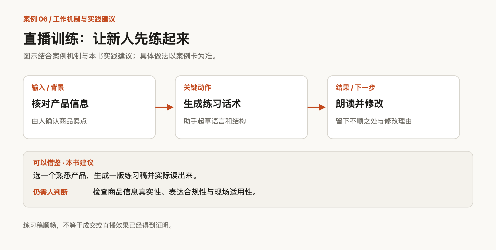
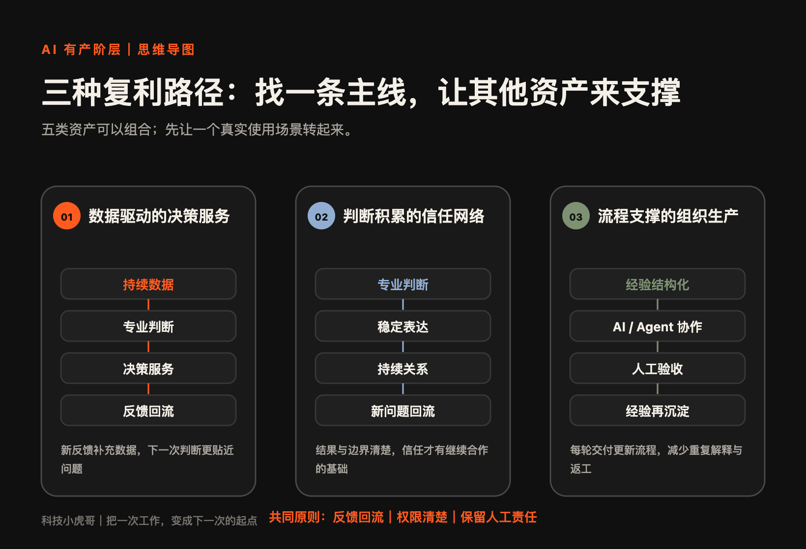
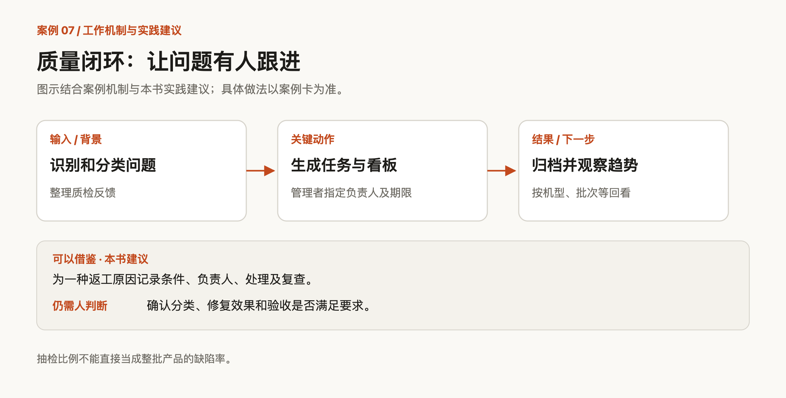
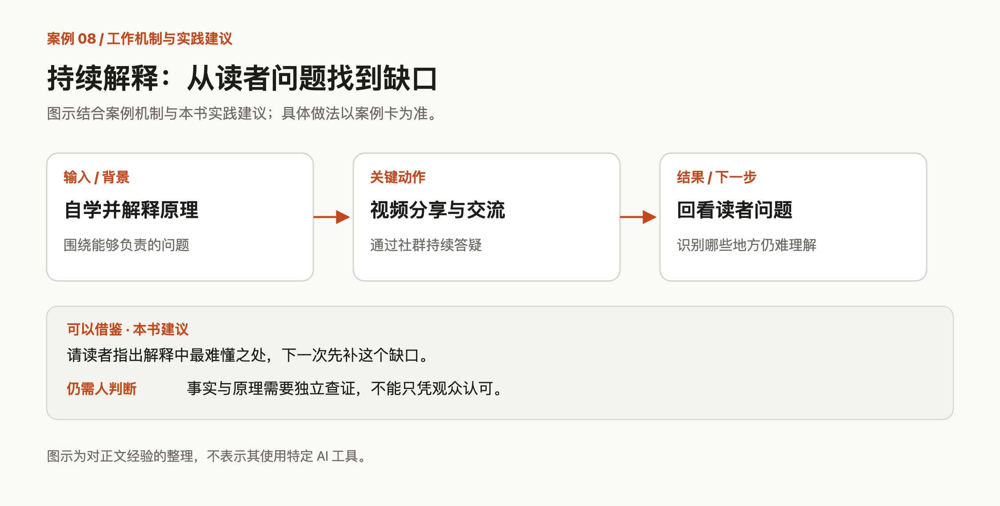
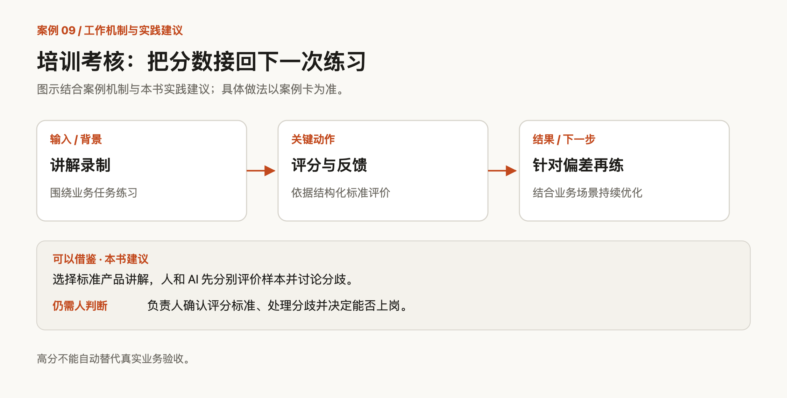
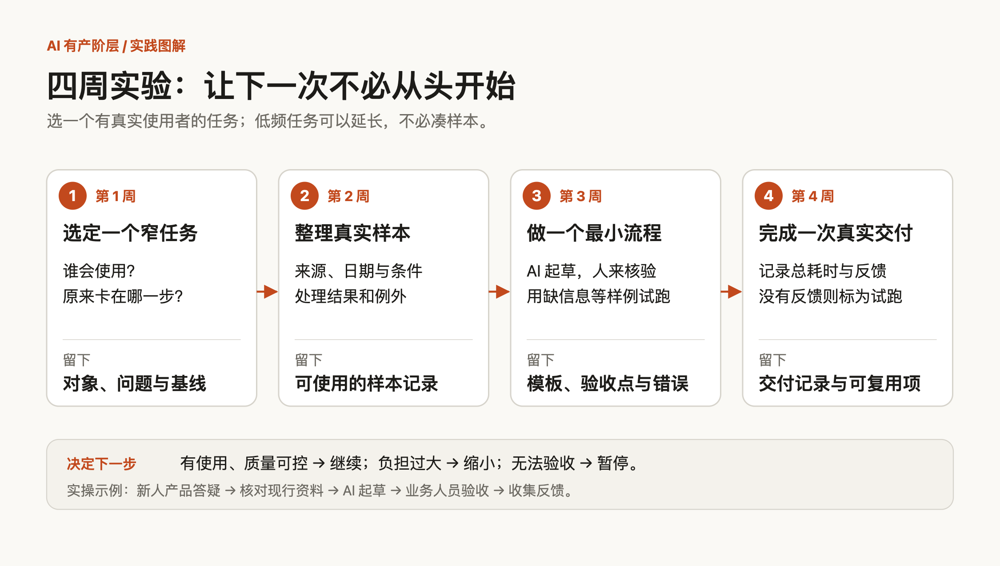
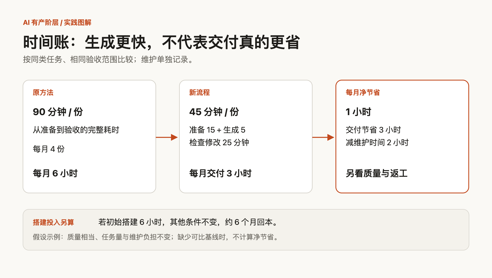
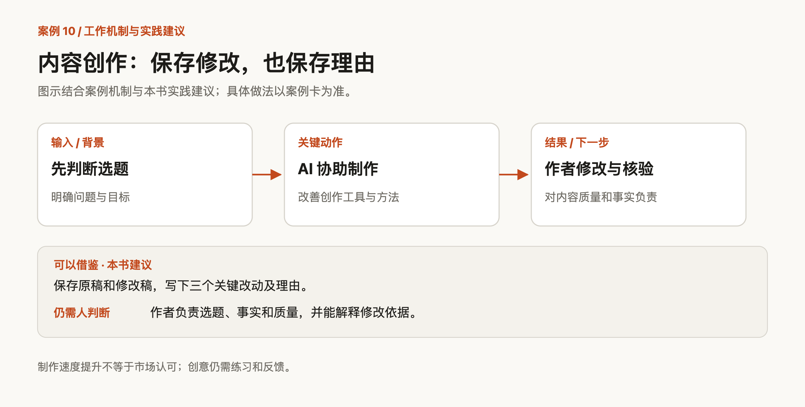
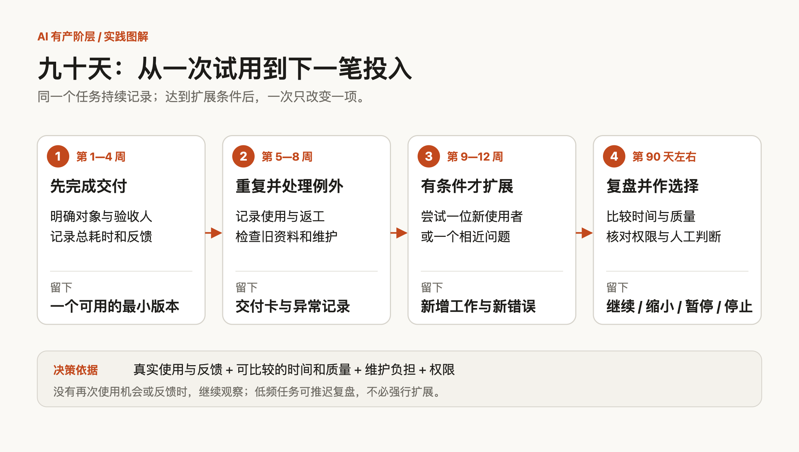

[← 返回首页](../README.md) | [← 五类资产与案例](02-五类资产与案例.md) | [实践画布与来源 →](04-实践画布与来源.md)

---

## 3. 资产如何产生复利

### 3.1 先在一个小地方让资产回路转起来

先选一个最小回路：过去三十天反复出现，有明确使用者和实际代价，能在较短时间拿到反馈，且资料允许使用。

完成一次任务，留下模板；下次使用时记下问题，再修订。一个使用者、一次练习，就可以开始。

> **案例卡 C06｜余探：先给新人主播一份练得起来的话术**
>
> **WHY原有痛点**　新人主播不会写话术，练习难开始，也容易受挫。若第一步就搭复杂系统，可能还没练一次就先陷入配置。
>
> **HOW接入**　围绕产品信息搭建直播运营助手，生成结构清楚、语言顺畅的练习话术，把起点放在一个具体的训练问题上。
>
> **WHAT学到什么**　可反复调用的练习模板；进一步记录实际使用中的卡点，才有机会积累适合不同产品和新人的调整办法。起步可以这样做：拿一个熟悉的产品试一次：先由人核对卖点，再生成话术、实际读出来、修改不顺的地方，并留下修改理由。
>
> **WHERE仍需人判断**　商品信息是否真实、表达是否合规、是否适合现场互动，需要人确认。练习稿顺畅，不等于成交或直播效果已得到证明。

这张练习稿若要继续积累，需把实际读出的卡点、改动和理由放回模板。一次只改一个主要问题，再看是否更适合使用。

更新资料与模板即可起步，无须先重训模型。确认有人持续使用，再加自动化。

### 3.2 把五类资产接成三种飞轮

三百份报告可能仍要从头翻，二十条带条件、判断和结果的记录，却可能直接支持行动。区别在于积累怎样进入下一次工作。

**复用摊薄成本，经过检验的反馈支持学习。** 交付后存档，还没有接上返回箭头；只有使用结果改变了后续的数据、判断或流程，回路才形成。

下面三种飞轮，分别从决策、关系和交付出发，帮助你选择起点。

*图 3｜三种飞轮及其反馈路径*

#### 3.2.1 飞轮一：先找到那个必须做的决定（数据驱动的决策服务）

发现异常或趋势之后，继续记录怎样处理、结果如何，数据才有机会改变下一次决策。

> **案例卡 C07｜迦沃科技：质量数据要有人接住，才会改变下一批货**
>
> **WHY原有痛点**　品质问题通过表格和群聊截图反馈，记录零散，谁负责跟进不够清楚。客户接受了，不等于小问题已经被消除。
>
> **HOW接入**　识别和分类质检问题，生成任务；管理者指定责任人、期限与优先级，再通过看板跟进。记录归档后，可按机型、批次和问题类型观察趋势。
>
> **WHAT学到什么**　问题记录、处理责任与长期趋势。把重复缺陷和处理结果放在一起，才有依据调整下一轮检查和改进重点。起步可以这样做：给一种常见返工原因建立记录：发生条件、负责人、处理办法、复查结果。月底看它是否重复，而不只是看任务关闭了多少。
>
> **WHERE仍需人判断**　问题分类是否正确、修复是否有效、是否满足验收要求，需要专业人员确认。不能把抽检样本中的比例直接当成整批产品缺陷率。

这里有两个闭环：处置闭环负责接单、修改和复查；学习闭环比较多次结果，修正检查重点或工艺。关闭任务完成前者，减少同类问题复发才更接近后者。

可以按月回看：同类缺陷为何重复，过去的处理是否仍有效，新异常是否需要另立规则。AI 协助归类，人解释条件差异。

数据服务则需要解决可比性与信用。Levels.fyi 在 2017 年从比较不同公司职级起步，逐步收集职级与薪资记录。其官网说明了核验、可疑记录排查、个人查询和企业对标服务，并声明不接受付费修改数字。这些是平台自述，不是独立质量审计。[平台关于我们页面](https://www.levels.fyi/about/)

它提供的对照是：数据要能比较，也要有核实、纠错与利益边界。

下面用企业销售做一次操作演示。

第一步，限定一个区域、一种客户和一个月内可验证的问题。记录事件、日期、来源、与自身业务的关系及待核信息。AI 负责抽取与归类；“扩招是否意味着采购需求”，仍是待验证的判断。

第二步，形成行动清单。例如本周优先联系三家企业，每家附一个依据、一个不确定性和一个要问的问题。

第三步，拜访后补回结果：需求是否存在、消息是否过时、谁参与决策。未回复只能记“未获得反馈”。

若连续沟通发现某类信号没有用，就调整跟踪重点，保留原始依据。几次巧合不足以证明规律，后续仍要验证。

这条回路积累的是“什么条件下，哪些信息支持哪种决定”。联系结果和误判原因，会使同一批公开资料产生不同的使用价值。

也要防止反馈把偏见放大：只记录成交，或只联系原本看好的客户，都会限制学习。留出少量反例，追踪未选中的机会后来怎样。

更新、授权、解释和定制服务仍有成本。十个客户各问不同的问题，可能仍是定制服务，不能按无限复制的数据产品来算收益。

**检验起点：使用者有没有据此行动，并把结果告诉你。** 若反馈只有“资料很全”，先调整交付，而非继续增加采集量。

#### 3.2.2 飞轮二：让别人知道你什么时候值得相信（专业判断与信任网络）

这条飞轮要回答：别人为什么愿意把下一次的问题交给你？

先选自己能持续判断、使用者也确实需要理解的主题。被看见之后，还要有机会交流具体条件。

> **案例卡 C08｜一位讲 AI 原理的科技博主：把持续解释接到持续交流**
>
> **WHY原有痛点**　没有技术背景，也有本职工作，很难靠追逐所有热点长期维持内容更新。
>
> **HOW接入**　通过自学持续制作视频，选择解释 AI 背后的原理，并建立社群，持续分享与答疑。
>
> **WHAT学到什么**　历史内容、读者反复提出的问题与交流关系。是否进一步形成更可靠的判断，还要看有没有检验答案和修正错误。起步可以这样做：围绕一个自己能负责的问题写一份解释，邀请使用者指出最难理解的部分；下一次先回答这个具体缺口。
>
> **WHERE仍需人判断**　解释原理同样需要查证。观众认可、加入社群或付费，都不能替代事实核验，也不能证明每条建议有效。

内容与答疑接通了，学习还需要结果回访：对方怎样理解，是否采用，哪里遇到困难，旧解释是否需要修订？社群存在，并不表示这些反馈已经回来。

假设一位招聘从业者帮助小团队招聘第一位运营。他可以先解释“为什么招了人，创始人反而更忙”：岗位没有稳定交付物，新增人员可能增加管理负担。这项判断不宜直接套到已有成熟分工的大团队。

有人来问，就追问业务阶段、已有分工和最卡的一步。得到允许后，把共性问题匿名整理为下一份内容。

一个月后再回访：是否采用？没有采用，是成本、优先级还是适用性问题？情况改善，也要检查同期是否换了负责人或调整产品，不能把全部变化算成建议的功劳。

研究者 Barbara Mellers 介绍的预测训练，强调概率、讨论与持续评估。普通人可以留下三句话：我倾向于什么，依据是什么，出现什么事实会改变判断。等结果出来，再回看原话。

AI 可以整理反馈、寻找相似案例和提示矛盾。解释两个案例为何不同，仍要自己练习。

维护信任还需要修正记录：改了哪句话，新证据是什么，旧建议对谁不再适用。省略例外、删除错误，可能短期提高吸引力，却让别人更难判断你是否可靠。

早期看三个信号：使用者是否带着具体问题回来，愿不愿意反馈，是否介绍同类需求。低频服务不必强求复购。

**信任有领域边界。** 选品信用不能直接换成投资信用；扩展服务，需要补上新能力的证据。

#### 3.2.3 飞轮三：把一次纠错变成下一次的条件（流程与组织生产）

新人反复提问，知识库能减少查找；资料过期后，也可能更快传播错误。流程飞轮需要接住使用与纠错的结果。

> **案例卡 C09｜毅恒团队：考核结束，下一次练习才开始**
>
> **WHY原有痛点**　培训与业务考核费时，评分不稳定，学员拿到一个分数后，也未必知道下一次该改什么。
>
> **HOW接入**　连接讲解录制、自动评分、反馈与练习，重点处理考核标准结构化、评分稳定和结合业务场景持续优化。
>
> **WHAT学到什么**　评分标准、练习材料、常见偏差与反馈记录。把同一种错误对应到下一次练习，才可能减少反复讲解。起步可以这样做：选一种容易验收的任务，例如标准产品讲解；先写清评分项，再让人和 AI 分别评价几个样本，讨论分歧之后才扩大使用。
>
> **WHERE仍需人判断**　评分项是否贴近实际工作、分歧怎样处理、是否能够独立上岗，需要负责人确认。高分不能自动替代真实业务验收。

总分可能掩盖不同问题：有人知识完整，却说不清适用条件；有人表达顺畅，却漏了不能承诺的事项。把偏差接到下一次练习，再检查是否改善。

标准也要被业务结果检验。高分者不断返工，可能意味着评分项遗漏了重要能力，需要修订。

《经济学季刊》一项研究观察了 5,172 名客服分阶段使用 AI 助手的变化：每小时解决问题数平均提高约 15%，经验较少者提升最明显，最高技能者的速度收益较小，部分质量指标略有下降。建议可被修改或忽略，客服仍负责对话。这支持经验进入工作的一种可能，不能当作所有团队的提效承诺。

小团队可以从标准产品答疑开始：让 AI 根据现行资料起草，由负责人验收。无来源的能力描述留空，价格、交期和合同承诺转给有权限的人。

发现错误后，要定位原因：资料过期、检索漏项、规则含糊，还是无依据推断？不同原因需要不同修改。

例如，AI 依据旧手册回答某设备适用于特定环境，人工发现新版改变了条件。修复应包括更新依据、标记旧版用途，并增加一个版本检查样例。下次重跑，才能确认修正有效。

同时保留两种工作入口：当场解决问题，定期回看共同缺口。过期规则可以退场，不必把每次纠错都永久追加到说明中。

建立小型验收集：正常问题、缺少信息、引用旧资料、需要转交人工。换模型或改流程时重跑。Anthropic 的工程文章强调具体任务与评分方式；小样本能帮助起步，不是统计可靠性的证明。

指定维护人决定哪些修改进入正式版本、哪些任务暂停自动处理。观察首次通过、错误复发和新人独立完成情况，比只统计回答次数更有用。

#### 3.2.4 最容易被漏掉的资产：下一次能接着用的中间成果

为回答一个问题，你读了五份文件，发现两份口径不同、一份已失效，最后形成建议。只保存建议，下次还要重新比较。

值得留下的中间成果包括：哪些数字不能直接比较，哪份文件替代旧规则，结论在哪些条件下成立。

AI 研究者 Andrej Karpathy 的 LLM Wiki 设想，把原始材料、持续维护的知识页和管理规则分开；新材料、提问和检查都用于修订知识。这是方法说明，并非独立验证的生产率研究。

在 Obsidian 或普通文件夹里，可以保留原文，再维护一页“当前判断”，写明依据、适用条件和变化。AI 协助整合，人核对关键差异。

推测必须标明，关键结论保留来源，新证据到来时修正旧判断，防止后续把自己的推测反复当作事实引用。

#### 3.2.5 三种飞轮怎样选，怎样接

| 你现在最有条件做的事 | 优先起点 | 第一份可用成果 | 必须接回来的反馈 |
| --- | --- | --- | --- |
| 经常拿到与某个决定有关的信息 | 数据驱动的决策服务 | 带来源、适用条件和待核问题的比较表 | 使用者最终怎样决定，哪些信息没有用 |
| 能解释某类问题，别人愿意听你判断 | 专业判断与信任网络 | 一份有适用边界的建议或分析 | 是否采用，实际困难，后来的变化 |
| 经常重复完成一类可验收的任务 | 流程与组织生产 | 有输入、依据、验收人的工作流程 | 失败原因，返工，知识缺口 |

优先选择能接触使用者、拿到结果的任务。没有反馈机会，先缩小问题或找到试用者。

三种飞轮可以渐次连接：比较表被使用后，才有条件整理判断；追问增加后，再考虑把重复服务流程化。每次扩展都应由真实需求推动。

先补交付中最薄弱的一环。数据不准时扩大传播，或没有验收时增加自动化，只会放大原有问题。接下来，还要核算维护成本。

### 3.3 复利不是躺赚，而是选择权增加

积累可能减少返工、增强议价与选择能力，但需要持续维护。旧政策可供历史比较，不能直接支持当年决策；过期的客户规则，也可能误导行动。

不是每份材料都值得维护。问自己：**如果今天删掉它，下一次工作会不会更难？** 若没有实际用途，继续整理可能只是在增加负担。

测量也能纠正效率错觉。METR 在 2025 年 7 月发布的随机对照研究中，16 名资深开发者完成 246 项熟悉项目的任务，使用当时 AI 工具平均多耗时 19%，却仍觉得变快了。结果仅适用于该样本、任务和工具。

2026 年 2 月的后续说明指出，人员和任务选择偏差使最新提效幅度难以可靠估计。旧数字不能直接套到新工具上；可借用的纪律是，记录自己从接到任务到验收的总耗时。

下面用一个四周实验，把五类资产和三种飞轮接到同一项工作上。先选有真实使用者、能拿到反馈的窄任务；样本不足或任务低频，就延长周期，不必凑数。

*图 4｜从窄问题到真实交付的四周实验*

**第一周：选一件反复发生的事。** 回看近三十天的工作，从 3.2.5 的三种飞轮里选择起点，写清谁在什么情况下需要作什么决定，以及现在哪里最费时。找不到试用者或使用权限不清，就先缩小范围。

**第二周：整理样本和判断。** 收集可使用的真实材料，建议最多先看十个；不足十个就如实记录。每条留下来源、日期、适用条件、处理结果和一个容易出错的地方，把敏感内容排除或按授权处理。

**第三周：做一个最小流程。** 选一个可验收的步骤，让 AI 依据已核对材料生成初稿；写下输入、输出、检查标准和必须转交人的情况。用正常、信息缺失和资料过期等样例试跑，记录错误并修正。

**第四周：完成一次真实交付。** 记录从准备到验收的总耗时、维护时间和使用者反馈，保存一条判断理由与下次可复用的材料。无法得到真实使用或反馈，就把它标为试跑，暂不宣称验证成功。

例如，借鉴钢贸产品推荐案例，先做“回答新人关于某一种产品适用条件的提问”，不做覆盖全部产品的助手。整理现行资料和几条真实问题，让 AI 起草回答；由业务人员核对版本、适用条件和例外，再请新人指出看不懂的地方。最终留下问答模板、来源和待补问题，而不是把 AI 的回答直接当成客户承诺。

附录的“四周实验画布”可直接填写；交付记录卡用于记录每次使用。四周后，根据真实使用、质量与维护成本选择继续、缩小或停止。

---

## 4. 从会用 AI，到经营一份自己的生产能力

小流程好用之后，容易走向两端：不断增加自动化，维护开始占满晚上；或始终留在自己的电脑里，组织只觉得你手快了一点。

**经营生产能力，需要把维护、使用与贡献纳入正常工作安排。**

### 4.1 先看自己的起点，别照搬别人的资产组合

新人先积累经过反馈的工作样本：独立判断一次，再与熟手对照，留下为什么不能这样答、哪些数据不能比较。3.2.3 的客服研究也显示，不同经验水平的收益不同。

熟手可以先整理例外、取舍和否决条件，减少每次都必须亲自解释的环节。

已有客户的人，先检查哪些交付拿不到后续结果，修好回访与记录，再扩展服务。

起点还受时间、权限和现金流限制。拿不到结果，不宜先建结果数据库；每天只有半小时，不宜维护需要频繁排错的系统。选一件当前工作中能够反复参与、看到反馈的事即可。

### 4.2 算清楚：省下的是时间，还是把时间挪到了别处

时间账要包含准备、生成、核验、沟通、返工和维护。

用一笔假设的时间账来说明。原来一份报告，从准备到验收要九十分钟；用了新流程，整理输入十五分钟，生成五分钟，检查与修改二十五分钟，共四十五分钟。每月做四次，账面上省三小时。但每月更新资料、处理异常，又花掉两小时，持续运行的净节省，只有一小时。

如果最初搭建用了六小时，在任务量和维护负担不变、质量相当的前提下，光靠省时间，大约要六个月才能回本。要是下个月这项任务取消，回本就不会按计划发生。

*图 5｜假设示例：把维护时间计入时间账*

质量收益另记：可追溯性、新人接手能力或关键遗漏的减少，可能比省时更重要，但不能用它们抬高净节省的数字。

省时也不直接等于增收。固定工资通常不随节省一小时增加；独立服务者仍需要付费需求、交付质量与价格支持。

每月分别看时间、质量和余量去向，另记工具与调用费用。维护是否可预期也很重要：每周固定十分钟的表格，可能比平时省心、偶尔整晚排错的系统更适合你。

### 4.3 「拥有」要落实到控制、使用和收益

拥有一份文件，要进一步检查五件事：是否理解，能否持续访问，有无复用权限，谁决定更新，收益怎样分配。

这些权利可能分散在个人、组织、客户与平台之间。整理了一套投标准备流程，也不能据此带走客户记录、报价和评审意见；一般方法与原始资料的使用约定，要分别确认。

组织内的积累同样有价值，关键在让贡献进入工作安排：谁使用这套方法，谁负责更新，为维护留多少时间，效果记在哪里，能不能成为培训、项目职责或绩效讨论的依据。先把这些谈清楚，比等别人自然注意到你的额外投入更可靠。

经验全留在脑子里，别人难接手；流程开放了却由你无偿处理全部异常，又会增加负担。让流程可用，同时让判断、维护和改进进入明确职责。

对独立服务者，控制还包括平台依赖。客户只能在一个平台找到你，材料只存在某个工具的对话里，一旦入口变化，连续工作就可能中断。没必要因此自建所有系统，但值得保留：合法可导出的资料，关键的判断，交付的版本，以及对方同意的联系渠道。

做一次停用检查：常用工具暂时不可用时，能否找到原始依据、解释当前工作，并完成最低限度的交付？答案会暴露哪些能力仍只依赖入口。

### 4.4 保留判断训练，别让系统比你懂得更多，却无人能核验

软件开发者 Simon Willison 用「认知债务」讨论一种处境：AI 加速了开发，人却渐渐失去对系统运行方式的理解，后续修改因此变难。这是从业者提出的解释框架，不是已有统一测量的定律。[来源：Interactive explanations](https://simonwillison.net/guides/agentic-engineering-patterns/interactive-explanations/)

客户分析生成了，你却说不清优先级为何变化；培训方案完整了，你却辨认不出遗漏。这时，成果增加了，理解没有跟上。

CHI 2025 一项对 319 名知识工作者的调查发现，对 AI 更有信心与较少的批判性思考相关。自报相关性不能证明永久能力退化，但提示我们检查核验投入。[研究论文](https://doi.org/10.1145/3706598.3713778)

> **案例卡 C10｜何秋剑：制作可以加速，创作思路仍要练**
>
> **WHY原有痛点**　内容制作能被工具加快，但更快地产出，并不能回答什么内容值得做、怎样修改才会被认可。
>
> **HOW接入**　在边学边做中使用 AI 改善创作工具与方法，同时强调人的创意和修改，不把批量生产等同于市场认可。
>
> **WHAT学到什么**　可保留选题理由、修改前后的版本，以及实际反馈；它们帮助区分工具做得快和作者判断得好。起步可以这样做：留下一份原稿和一份修改稿，只写三个关键改动及理由。下一次先作判断，再让工具协助，最后对照效果。
>
> **WHERE仍需人判断**　这是创作者的经验观点，不能推出 AI 必然无法参与创意。最终选题、事实与质量，需要作者自己能解释、能负责。

关键任务先留一步独立判断：看模型答案前，写下最担心的问题、需要的证据与合格标准，再对照输出。

有分歧就回到原始资料，或请合适的人核对，别只让同一个模型反复解释。

定期脱离现成答案，说清一个任务的处理顺序、资料缺口和停止条件。能辨认错误，验收职责才有实际作用。

### 4.5 从一个好用的小流程，走到可持续的九十天

最初四周验证首次使用，后两个月观察持续运行。九十天是安排节奏的建议，不是成功期限，也不要求每项任务都在九十天内完成。

**第 1—4 周：完成第一次可验收交付。** 用附录画布选定对象、任务和验收人，记录样本、人工判断、总耗时与反馈。先留下可复用的最小版本。

**第 5—8 周：在相同范围内重复使用。** 每次用交付记录卡记实际调用、返工、错误类型和维护时间；至少回看一次缺资料、旧资料和例外如何处理。没有再次使用机会，就保留现状、继续观察，不把零次复用解释为失败。

**第 9—12 周：只在有需求且前一版本可控时，试一个相邻变化。** 比如在产品答疑中换一位新人，或增加一个相近产品问题；不同时更换对象、资料和工具。记录新增工作和新错误，无法获得反馈时不扩展。

**第 90 天左右：拿记录作决定。** 比较相近任务的完整交付时间与质量，另计维护；核对资料权限和人是否仍能解释关键判断。按下表选择继续、缩小、暂停或停止，并写下下一次检查时间。附录提供可填写的复盘画布。

*图 6｜用真实记录决定是否继续投入*

Anthropic 的工程经验也主张从简单方案开始，按需要增加复杂度。需求未稳时先用模板与人工检查，固定步骤验证后再扩展。
下面这张表，用来决定下一笔投入，不是给自己打分。

| 观察到的情况 | 下一步选择 | 需要补上的证据 |
| --- | --- | --- |
| 同类任务持续有人用，质量稳定，维护负担可承受 | 继续，试着扩展一个相邻用途 | 新用途是否仍能复用原有材料与规则 |
| 需求真实，但每次都要大量临时解释 | 缩小对象或交付范围 | 哪些差异值得定制，哪些可以统一 |
| 生成更快，核验和返工却持续增加 | 降低自动化，修正输入和验收 | 完整交付时间与错误类型是否改善 |
| 工具、政策或材料改变，旧规则开始失效 | 暂停受影响的部分，更新后再验证 | 新版本通过哪些旧样例和新例外 |
| 长期没有实际使用，或机会成本明显更高 | 停止主动维护，保留必要历史 | 未来什么条件出现，才值得重启 |

发现需求分散、反馈太慢，就可以缩小或停止。已投入很久，不是继续维护的充分理由。

模型或业务变化后，旧步骤也可能退场。定期删除失效规则，让有效经验继续被调用。

### 4.6 把增长的能力，换成你真正想要的选择

省下的时间若被更多任务填满，产出增加，生活未必改善。扩张前，先安排收益去向：更有积累的任务、更好的交付、更少的临时加班，或拒绝不合适的项目。

经营这份能力，应当让你知道能承接什么、代价多少、哪些可以不做。把下一阶段的选择写下来，并用附录的交付记录卡和九十天复盘页检验。

> **未来九十天，我只经营这一项能力：** ＿＿＿。  
> **它服务的人与反复出现的决定：** ＿＿＿。  
> **我有权持续使用的材料，以及我保留的判断：** ＿＿＿。  
> **我每周愿意投入的维护时间：** ＿＿＿。  
> **我用什么真实结果判断它有效：** ＿＿＿。  
> **出现什么情况，我会缩小或停止：** ＿＿＿。  
> **它节省的时间或增加的收益，我准备先用于：** ＿＿＿。

“AI 有产阶层”是一种工作方式，不是人的价值排序，也不必把所有劳动和关系都变成资产。

回到最初的问题：用完 AI，你留下了什么？当积累能在有权使用的范围内支持下一次行动，它才开始成为生产能力。规模可以很小，但应当让你的选择逐渐变多。

---

---

[← 返回首页](../README.md) | [← 五类资产与案例](02-五类资产与案例.md) | [实践画布与来源 →](04-实践画布与来源.md)
